## 🌱 关于我

- 从「看博客」到「做得出」：中间隔着的每一行代码都算数
- 🎓 在校学生，正在系统学习 Python 与 AI（LLM / PyTorch）
- ✍️ 学法是「边做边学」：每学完一小块内容，就写一个小工具或一份笔记放上来
- 🌿 这个主页会跟着项目一起生长 —— 你现在看到的是第 2 版

## 🧰 技术栈

**语言与基础**


**AI 与数据**


**正在学**


## 📈 正在学习

| | | |
|:---:|:---:|:---:|
|  |  |  |
|  |  |  |

## 📮 联系我

```bash
$ mail -s "你好" ljh-ningxia@users.noreply.github.com
# 任何仓库的 issue / PR 都开放，欢迎交流
```
